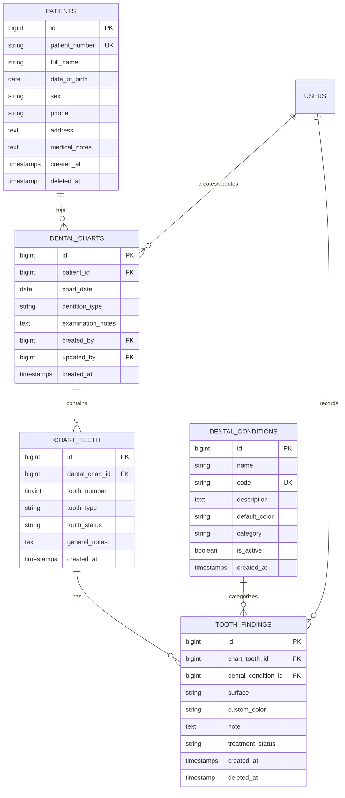

# Dental Chart System - Development History & Continuation Guide

**Project:** Dental Chart Workspace (Laravel 11)  
**Last Updated:** October 26, 2026  
**Status:** All CRUD modules, API endpoints, interactive chart integration, database seeders, and automated tests are implemented and passing (60/60 assertions).

---

## 1. Executive Summary & Architecture

The application is an interactive clinical dental charting system adhering to the **FDI World Dental Federation two-digit tooth numbering system**:
- **Permanent Arch (32 teeth):** Quadrants 1 to 4 (`18–11`, `21–28`, `48–41`, `31–38`)
- **Primary Arch (20 teeth):** Quadrants 5 to 8 (`55–51`, `61–65`, `85–81`, `71–75`)
- **Interactive Tooth Silhouette:** Each tooth consists of 5 individually clickable surface polygons (`top`, `bottom`, `left`, `right`, `center`) plus whole-tooth selection (`whole`).

The system supports dual-mode operation:
1. **Interactive Demo / Offline Mode:** Uses `localStorage` cache.
2. **Database Connected Mode:** Seamlessly loads patient records and synchronizes tooth findings directly with PostgreSQL/MySQL via RESTful API.

---

## 2. Work Done (Completed History)

### Phase 1: Interactive Blade View & Route
- **View:** Created [`resources/views/dental.blade.php`](resources/views/dental.blade.php) containing the complete interactive SVG arch layout, modal editor, filter buttons (All / Permanent / Primary), color swatches, JSON export, and print styling.
- **Route:** Added `/dental` web route.

### Phase 2: Database Migration Fixes
- **Migration Inspected:**
  1. `2026_01_01_000001_create_patients_table.php` (`patients`)
  2. `2026_01_01_000002_create_dental_charts_table.php` (`dental_charts`)
  3. `2026_01_01_000003_create_chart_teeth_table.php` (`chart_teeth`)
  4. `2026_01_01_000004_create_dental_conditions_table.php` (`dental_conditions`)
  5. `2026_01_01_000005_create_tooth_findings_table.php` (`tooth_findings`)
- **Fix:** In `2026_01_01_000005_create_tooth_findings_table.php`, adjusted `$table->foreignId('chart_tooth_id')->constrained('chart_teeth')` to reference the irregular plural `chart_teeth` instead of the Laravel default assumption `chart_tooths`.
- **Config:** Fixed leading whitespace in `.env` for `DB_DATABASE=dental_chart`.

### Phase 3: Eloquent Models & Relationships
Created 5 core models with full attributes, casts, and relations:
- [`app/Models/Patient.php`](app/Models/Patient.php): SoftDeletes, `dentalCharts()` relation.
- [`app/Models/DentalChart.php`](app/Models/DentalChart.php): `patient()`, `teeth()`, `findings()` (`HasManyThrough`), `creator()`, `updater()`.
- [`app/Models/ChartTooth.php`](app/Models/ChartTooth.php): Table `chart_teeth`, `dentalChart()`, `findings()`.
- [`app/Models/DentalCondition.php`](app/Models/DentalCondition.php): `findings()`, `creator()`.
- [`app/Models/ToothFinding.php`](app/Models/ToothFinding.php): SoftDeletes, `chartTooth()`, `condition()`, `creator()`, `updater()`.

### Phase 4: Form Requests (Validation Layer)
- [`PatientRequest.php`](app/Http/Requests/PatientRequest.php): Handles unique constraint with ignore on update.
- [`DentalChartRequest.php`](app/Http/Requests/DentalChartRequest.php): Validates patient and chart dates.
- [`ChartToothRequest.php`](app/Http/Requests/ChartToothRequest.php): Composite unique validation `['dental_chart_id', 'tooth_number']`.
- [`DentalConditionRequest.php`](app/Http/Requests/DentalConditionRequest.php): Validates condition codes and hex color regex (`/^#[0-9a-fA-F]{6}$/`).
- [`ToothFindingRequest.php`](app/Http/Requests/ToothFindingRequest.php): Validates surfaces and clinical treatment statuses.
- [`SyncChartFindingsRequest.php`](app/Http/Requests/SyncChartFindingsRequest.php): Validates bulk findings sent by the interactive frontend.

### Phase 5: Web UI & CRUD Controllers
- **Shared Layout:** [`resources/views/layouts/app.blade.php`](resources/views/layouts/app.blade.php) with top navigation and alerts.
- **Home Dashboard:** [`resources/views/welcome.blade.php`](resources/views/welcome.blade.php).
- **Patient Management:** [`app/Http/Controllers/PatientController.php`](app/Http/Controllers/PatientController.php) with full views (`index`, `create`, `edit`, `show`).
- **Dental Charts Management:** [`app/Http/Controllers/DentalChartController.php`](app/Http/Controllers/DentalChartController.php) with views (`index`, `create`, `edit`).
- **Condition Settings & Legend:** [`app/Http/Controllers/DentalConditionController.php`](app/Http/Controllers/DentalConditionController.php) with views (`index`, `create`, `edit`).
- **Interactive Chart Controller:** [`app/Http/Controllers/DentalViewController.php`](app/Http/Controllers/DentalViewController.php) handling `/dental` and `/dental/{chart}`.

### Phase 6: RESTful API Layer ([`routes/api.php`](routes/api.php))
Created dedicated API controllers under `app/Http/Controllers/Api/`:
- `Api/PatientController.php` (`GET|POST /api/patients`, `GET|PUT|DELETE /api/patients/{id}`)
- `Api/DentalChartController.php` (`GET|POST /api/dental-charts`, `GET|PUT|DELETE /api/dental-charts/{id}`)
- `POST /api/dental-charts/{id}/sync-findings`: Bulk upsert/delete of tooth findings.
- `Api/ChartToothController.php` (`/api/chart-teeth`)
- `Api/DentalConditionController.php` (`/api/dental-conditions`)
- `Api/ToothFindingController.php` (`/api/tooth-findings`)

### Phase 7: Seeders & Database Initialization
- [`database/seeders/DentalConditionSeeder.php`](database/seeders/DentalConditionSeeder.php): Seeds 8 clinical conditions:
  - Caries / decay (`#d83c43`)
  - Existing restoration (`#2f66cf`)
  - Treatment planned (`#e59b26`)
  - Completed treatment (`#319b62`)
  - Missing tooth (`#707782`)
  - Crown (`#8b5bc7`)
  - Fracture (`#8a5a38`)
  - Sealant (`#169d9a`)
- [`database/seeders/DatabaseSeeder.php`](database/seeders/DatabaseSeeder.php): Seeds default doctor user, condition catalog, sample patient (`Jane Williams`), and chart with tooth 23 finding.

### Phase 8: Testing & Verification
- Test suites:
  - [`tests/Feature/DentalCrudTest.php`](tests/Feature/DentalCrudTest.php): Tests seeder, web CRUD, finding sync, and interactive views.
  - [`tests/Feature/DentalApiTest.php`](tests/Feature/DentalApiTest.php): Tests API endpoints for patients, conditions, teeth, and findings.
- **Results:** 9 test cases passed with **60 assertions** (100% green).

---

## 3. Database Schema Overview



---

## 4. Key Route Directory

### Web Routes
- `GET /` -> Welcome dashboard
- `GET /dental` -> Interactive chart (standalone or chart selector)
- `GET /dental/{chart}` -> Interactive chart for a specific patient session
- `GET|POST /patients` -> Patient index & store
- `GET /patients/create` -> New patient form
- `GET|PUT|DELETE /patients/{patient}` -> Patient details, update, delete
- `GET /patients/{patient}/edit` -> Edit patient form
- `GET|POST /dental-charts` -> Dental charts list & store
- `GET /dental-charts/create` -> Create chart for patient
- `GET|PUT|DELETE /dental-charts/{chart}` -> Chart details, update, delete
- `GET /dental-charts/{chart}/edit` -> Edit chart form
- `GET|POST /dental-conditions` -> Condition list & store
- `GET /dental-conditions/create` -> New condition form
- `GET|PUT|DELETE /dental-conditions/{condition}` -> Update & delete condition
- `GET /dental-conditions/{condition}/edit` -> Edit condition form

### API Routes (Prefix: `/api`, Name: `api.*`)
- `/api/patients` -> `Api\PatientController`
- `/api/dental-charts` -> `Api\DentalChartController`
- `/api/dental-charts/{chart}/sync-findings` -> Bulk sync findings
- `/api/chart-teeth` -> `Api\ChartToothController`
- `/api/dental-conditions` -> `Api\DentalConditionController`
- `/api/tooth-findings` -> `Api\ToothFindingController`

---

## 5. Checklist for Continuing Our Work

Here is the prioritized checklist to continue building the system:

### 1. Database Connection & Migration (Local Environment)
- [ ] Ensure PostgreSQL (or MySQL) service is running:
  ```bash
  # Check status
  service postgresql status
  ```
- [ ] Run migrations and seed data:
  ```bash
  php artisan migrate --seed
  ```
  *(This will load the default dental condition palette and the sample patient chart).*

### 2. Authentication & Multi-User Integration
- [ ] Install Laravel Breeze or Jetstream if doctor/staff login is required:
  ```bash
  composer require laravel/breeze --dev
  php artisan breeze:install blade
  ```
- [ ] Link `Auth::id()` automatically to `created_by` / `updated_by` fields on charts and tooth findings.

### 3. Patient Chart Enhancements
- [ ] **Chart History Comparison:** Add side-by-side view comparing baseline vs current examination chart.
- [ ] **Treatment Plan & Cost Estimation:** Link `treatment_status` (`planned`, `in_progress`, `completed`) to procedure fees / invoice generation.
- [ ] **Periodontal Charting:** Add pocket depth (PD), bleeding on probing (BOP), and gingival recession inputs.
- [ ] **PDF Export:** Implement DomPDF or Snappy/Browsershot to generate printable medical dental charts with clinic logo and doctor signature line.

### 4. Running Tests
Whenever new features or changes are made, run the automated suite:
```bash
php artisan test
```

