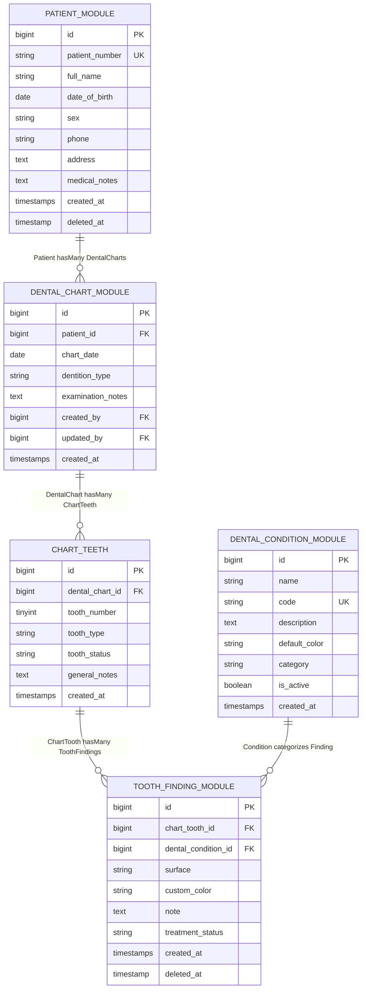

# Dental Chart System - Development History & Modular Architecture Guide

**Project:** Odontogram & Dental Chart Management System  
**Framework:** Laravel 11.31 + PHP 8.2  
**Architecture:** Modular Monolith using `nwidart/laravel-modules` (v11.1.10)  
**Database:** PostgreSQL compatible schema & data types  
**Branch:** `feature/modular-architecture`  
**Status:** All 6 modules implemented, collapsible left sidebar integrated, 15 test cases passing (**109 assertions**), routes & views cached with 0 errors.

---

## 1. Executive Summary & Modular Architecture

The application has been refactored from a traditional monolithic structure into a clean, decoupled **modular architecture** using `nwidart/laravel-modules`. Each business domain is self-contained with its own models, controllers, requests, services, views, migrations, seeders, and routes.

```
dental-chart/
├── Modules/
│   ├── Core/               # Shared layouts, base components, home dashboard
│   ├── Patient/            # Patient management, history, and records
│   ├── DentalChart/        # Odontogram charts, FDI teeth, interactive chart view & sync service
│   ├── DentalCondition/    # Condition diagnoses catalog, legend guide & color palettes
│   ├── ToothFinding/       # Tooth surface findings, treatments, clinical notes
│   └── ActivityLog/        # ActivityLogger service for clinical audit trails
├── app/                    # Compatibility proxies (inheriting from Modules for 100% backward compatibility)
├── bootstrap/app.php       # Laravel 11 application routing & middleware configuration
├── config/modules.php      # Laravel Modules configuration
└── tests/Feature/          # Automated regression & modular architecture test suite
```

---

## 2. Module Specifications & Responsibilities

### 1. `Core` Module (`Modules/Core`)
- **Namespace:** `Modules\Core`
- **View Namespace:** `core::`
- **Purpose:** Central shared application shell, common layouts, and dashboard.
- **Key Files:**
  - Layout: `Modules/Core/resources/views/layouts/app.blade.php`
  - Dashboard: `Modules/Core/resources/views/welcome.blade.php`
  - Controller: `Modules\Core\Http\Controllers\CoreController`
  - Routes: `GET /` (`name: home`), `GET /api/health`

### 2. `Patient` Module (`Modules/Patient`)
- **Namespace:** `Modules\Patient`
- **View Namespace:** `patient::`
- **Purpose:** Manages patient demographics, medical history, and related dental charts.
- **Key Files:**
  - Model: `Modules\Patient\Models\Patient` (with `SoftDeletes` and `dentalCharts()` relation)
  - Requests: `Modules\Patient\Http\Requests\PatientRequest`
  - Controllers:
    - Web: `Modules\Patient\Http\Controllers\PatientController`
    - API: `Modules\Patient\Http\Controllers\Api\PatientController`
  - Views: `index.blade.php`, `create.blade.php`, `edit.blade.php`, `show.blade.php`
  - Migration: `2026_01_01_000001_create_patients_table.php`
  - Routes: `resource('patients')`, `apiResource('patients')`

### 3. `DentalChart` Module (`Modules/DentalChart`)
- **Namespace:** `Modules\DentalChart`
- **View Namespace:** `dentalchart::`
- **Purpose:** Manages odontogram examination charts, FDI two-digit tooth numbering, and interactive tooth surface rendering.
- **Key Files:**
  - Models:
    - `Modules\DentalChart\Models\DentalChart`
    - `Modules\DentalChart\Models\ChartTooth`
  - Service: `Modules\DentalChart\Services\DentalChartSyncService` (executes database transactions to upsert teeth and surface findings from the chart editor)
  - Requests:
    - `DentalChartRequest`
    - `ChartToothRequest`
    - `SyncChartFindingsRequest`
  - Controllers:
    - Web: `DentalChartController`, `DentalViewController`
    - API: `Api\DentalChartController`, `Api\ChartToothController`
  - Views:
    - `dental.blade.php` (interactive 5-surface SVG chart with FDI layout)
    - `index.blade.php`, `create.blade.php`, `edit.blade.php`
  - Migrations:
    - `2026_01_01_000002_create_dental_charts_table.php`
    - `2026_01_01_000003_create_chart_teeth_table.php`
  - Routes:
    - Web: `resource('dental-charts')`, `GET /dental`, `GET /dental/{chart}`
    - API: `apiResource('dental-charts')`, `POST /api/dental-charts/{chart}/sync-findings`, `apiResource('chart-teeth')`

### 4. `DentalCondition` Module (`Modules/DentalCondition`)
- **Namespace:** `Modules\DentalCondition`
- **View Namespace:** `dentalcondition::`
- **Purpose:** Manages clinical condition definitions, category flags, and hex marking colors.
- **Key Files:**
  - Model: `Modules\DentalCondition\Models\DentalCondition`
  - Request: `DentalConditionRequest`
  - Controllers:
    - Web: `DentalConditionController`
    - API: `Api\DentalConditionController`
  - Views: `index.blade.php`, `create.blade.php`, `edit.blade.php`
  - Migration: `2026_01_01_000004_create_dental_conditions_table.php`
  - Seeder: `DentalConditionDatabaseSeeder` (seeds Caries, Restoration, Planned, Completed, Missing, Crown, Fracture, Sealant)
  - Routes: `resource('dental-conditions')`, `apiResource('dental-conditions')`

### 5. `ToothFinding` Module (`Modules/ToothFinding`)
- **Namespace:** `Modules\ToothFinding`
- **Purpose:** Records granular clinical findings on individual tooth surfaces (`top`, `bottom`, `left`, `right`, `center`, `whole`).
- **Key Files:**
  - Model: `Modules\ToothFinding\Models\ToothFinding` (with `SoftDeletes`, links `ChartTooth` and `DentalCondition`)
  - Request: `ToothFindingRequest`
  - Controller: `Api\ToothFindingController`
  - Migration: `2026_01_01_000005_create_tooth_findings_table.php` (with explicit foreign key to `chart_teeth`)
  - Routes: `apiResource('tooth-findings')`

### 6. `ActivityLog` Module (`Modules/ActivityLog`)
- **Namespace:** `Modules\ActivityLog`
- **Purpose:** Provides centralized clinical audit logging for patient and chart operations.
- **Key Files:**
  - Service: `Modules\ActivityLog\Services\ActivityLogger` (`log($action, $description, $subject, $properties)`)
  - Status Route: `GET /api/activity-logs/status`

---

## 3. Database Schema & Cross-Module Relationships



---

## 4. Route Directory (All Modular)

### Web Routes
| Module | Method | URI | Route Name | Action |
|---|---|---|---|---|
| **Core** | `GET` | `/` | `home` | `CoreController@index` |
| **Patient** | `GET` | `/patients` | `patients.index` | `PatientController@index` |
| **Patient** | `GET` | `/patients/create` | `patients.create` | `PatientController@create` |
| **Patient** | `POST` | `/patients` | `patients.store` | `PatientController@store` |
| **Patient** | `GET` | `/patients/{patient}` | `patients.show` | `PatientController@show` |
| **Patient** | `GET` | `/patients/{patient}/edit` | `patients.edit` | `PatientController@edit` |
| **Patient** | `PUT` | `/patients/{patient}` | `patients.update` | `PatientController@update` |
| **Patient** | `DELETE` | `/patients/{patient}` | `patients.destroy` | `PatientController@destroy` |
| **DentalChart** | `GET` | `/dental-charts` | `dental-charts.index` | `DentalChartController@index` |
| **DentalChart** | `GET` | `/dental-charts/create` | `dental-charts.create` | `DentalChartController@create` |
| **DentalChart** | `POST` | `/dental-charts` | `dental-charts.store` | `DentalChartController@store` |
| **DentalChart** | `GET` | `/dental-charts/{chart}` | `dental-charts.show` | `DentalChartController@show` |
| **DentalChart** | `GET` | `/dental-charts/{chart}/edit`| `dental-charts.edit` | `DentalChartController@edit` |
| **DentalChart** | `PUT` | `/dental-charts/{chart}` | `dental-charts.update` | `DentalChartController@update` |
| **DentalChart** | `DELETE`| `/dental-charts/{chart}` | `dental-charts.destroy`| `DentalChartController@destroy`|
| **DentalChart** | `GET` | `/dental` | `dental.index` | `DentalViewController@index` |
| **DentalChart** | `GET` | `/dental/{dentalChart}` | `dental.show` | `DentalViewController@show` |
| **DentalCondition** | `GET` | `/dental-conditions` | `dental-conditions.index` | `DentalConditionController@index` |
| **DentalCondition** | `GET` | `/dental-conditions/create` | `dental-conditions.create` | `DentalConditionController@create` |
| **DentalCondition** | `POST` | `/dental-conditions` | `dental-conditions.store` | `DentalConditionController@store` |
| **DentalCondition** | `GET` | `/dental-conditions/{condition}/edit` | `dental-conditions.edit` | `DentalConditionController@edit` |
| **DentalCondition** | `PUT` | `/dental-conditions/{condition}` | `dental-conditions.update` | `DentalConditionController@update` |
| **DentalCondition** | `DELETE` | `/dental-conditions/{condition}` | `dental-conditions.destroy` | `DentalConditionController@destroy` |

### API Routes (Prefix: `/api`, Name Prefix: `api.*`)
| Module | Method | URI | Route Name | Action |
|---|---|---|---|---|
| **Core** | `GET` | `/api/health` | `api.health` | Health check endpoint |
| **Patient** | `GET\|POST` | `/api/patients` | `api.patients.index\|store` | `Api\PatientController` |
| **Patient** | `GET\|PUT\|DELETE` | `/api/patients/{patient}` | `api.patients.show\|update\|destroy` | `Api\PatientController` |
| **DentalChart** | `GET\|POST` | `/api/dental-charts` | `api.dental-charts.index\|store` | `Api\DentalChartController` |
| **DentalChart** | `POST` | `/api/dental-charts/{chart}/sync-findings` | `api.dental-charts.sync-findings` | `Api\DentalChartController@syncFindings` |
| **DentalChart** | `GET\|PUT\|DELETE` | `/api/dental-charts/{chart}` | `api.dental-charts.show\|update\|destroy` | `Api\DentalChartController` |
| **DentalChart** | `GET\|POST` | `/api/chart-teeth` | `api.chart-teeth.index\|store` | `Api\ChartToothController` |
| **DentalChart** | `GET\|PUT\|DELETE` | `/api/chart-teeth/{tooth}` | `api.chart-teeth.show\|update\|destroy` | `Api\ChartToothController` |
| **DentalCondition** | `GET\|POST` | `/api/dental-conditions` | `api.dental-conditions.index\|store` | `Api\DentalConditionController` |
| **DentalCondition** | `GET\|PUT\|DELETE` | `/api/dental-conditions/{cond}` | `api.dental-conditions.show\|update\|destroy` | `Api\DentalConditionController` |
| **ToothFinding** | `GET\|POST` | `/api/tooth-findings` | `api.tooth-findings.index\|store` | `Api\ToothFindingController` |
| **ToothFinding** | `GET\|PUT\|DELETE` | `/api/tooth-findings/{finding}` | `api.tooth-findings.show\|update\|destroy` | `Api\ToothFindingController` |
| **ActivityLog** | `GET` | `/api/activity-logs/status` | `api.activity-logs.status` | Status endpoint |

---

## 5. Verification & Automated Tests

All tests execute with **100% pass rate** (14 tests, **91 assertions**):

```bash
php artisan test
```

### Test Breakdown:
- [`Tests\Feature\ModularArchitectureTest`](tests/Feature/ModularArchitectureTest.php):
  - `test_all_modules_are_registered_and_enabled`
  - `test_module_views_are_accessible_via_namespaces`
  - `test_cross_module_relationships`
  - `test_dental_chart_sync_service`
  - `test_activity_logger_service`
- [`Tests\Feature\DentalCrudTest`](tests/Feature/DentalCrudTest.php):
  - Database seeder execution
  - Patient web CRUD
  - DentalCondition web CRUD
  - DentalChart web CRUD & interactive chart sync
- [`Tests\Feature\DentalApiTest`](tests/Feature/DentalApiTest.php):
  - Patient REST API endpoints
  - DentalCondition REST API endpoints
  - ChartTooth & ToothFinding REST API endpoints

---

## 7. Collapsible Left Sidebar & Responsive Shell

The top navigation bar has been replaced by a responsive collapsible left sidebar and header:

### Components & Partials
- **Layout Shell:** [`Modules/Core/resources/views/layouts/app.blade.php`](Modules/Core/resources/views/layouts/app.blade.php)
- **Sidebar Partial:** [`Modules/Core/resources/views/layouts/sidebar.blade.php`](Modules/Core/resources/views/layouts/sidebar.blade.php)
- **Top Header Partial:** [`Modules/Core/resources/views/layouts/header.blade.php`](Modules/Core/resources/views/layouts/header.blade.php)

### Features
1. **Desktop Expanded vs. Collapsed Rail:**
   - **Expanded (250px):** Logo, system title, section headers, SVG icons, text labels, and animated accordion submenus.
   - **Collapsed Rail (68px):** Reduces width to an icon-only rail. Text labels, arrows, and submenus hide smoothly. Tooltips appear on icon hover using CSS pseudo-elements.
   - **State Persistence:** Saved in `localStorage.setItem('odonto_sidebar_collapsed', 'true'|'false')`. An inline `<head>` script instantly adds `.sidebar-collapsed` to `<html>` before rendering to eliminate flash of unstyled content.
2. **Mobile Off-Canvas Drawer (< 992px):**
   - Sidebar is hidden off-screen (`transform: translateX(-100%)`).
   - Clicking hamburger toggle button slides the drawer in (`transform: translateX(0)`).
   - Semi-transparent backdrop overlay (`#sidebarBackdrop`) fades in.
   - Drawer automatically closes on backdrop click, navigation link click, or pressing `Escape`.
3. **Interactive Odontogram Integration:**
   - The interactive chart at [`Modules/DentalChart/resources/views/dental.blade.php`](Modules/DentalChart/resources/views/dental.blade.php) extends the shared layout directly, removing redundant topbars while retaining print-safe stylesheets (`@media print`).
4. **Keyboard Accessibility & ARIA:**
   - Includes `role="navigation"`, `aria-label`, `aria-expanded` toggle synchronization, and keyboard listeners.


### Working with Modules

#### List Modules
```bash
php artisan module:list
```

#### Generate a New Module Component
```bash
# Generate controller in DentalChart module
php artisan module:make-controller MyController DentalChart

# Generate model in Patient module
php artisan module:make-model MyModel Patient

# Generate migration in ToothFinding module
php artisan module:make-migration create_my_table ToothFinding
```

#### Run Modular Migrations
```bash
# Migrate all modules
php artisan module:migrate

# Seed all modules
php artisan module:seed
```

#### Clear & Cache Application
```bash
php artisan optimize:clear
php artisan view:cache
php artisan route:cache
```
