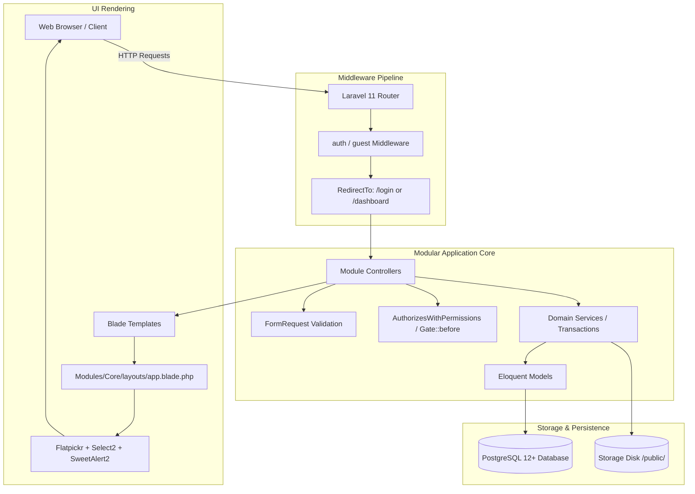
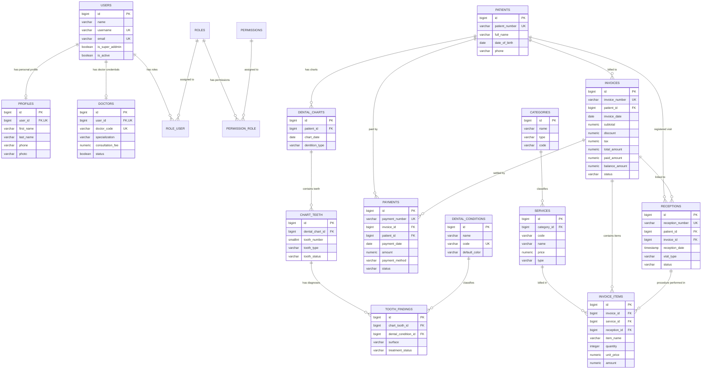
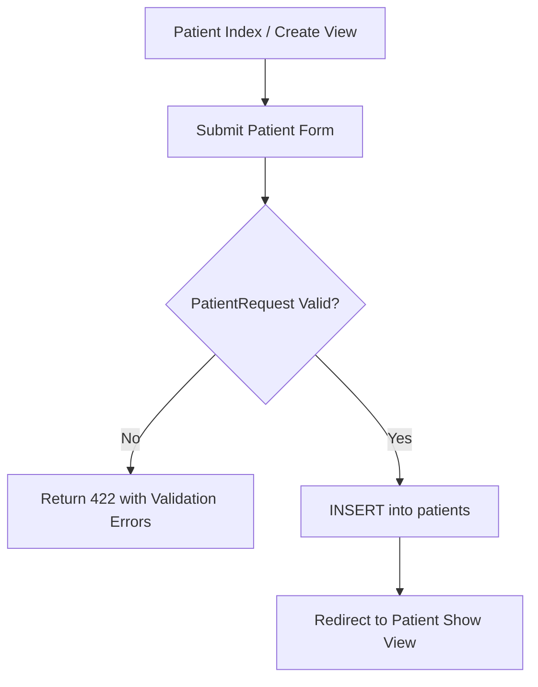
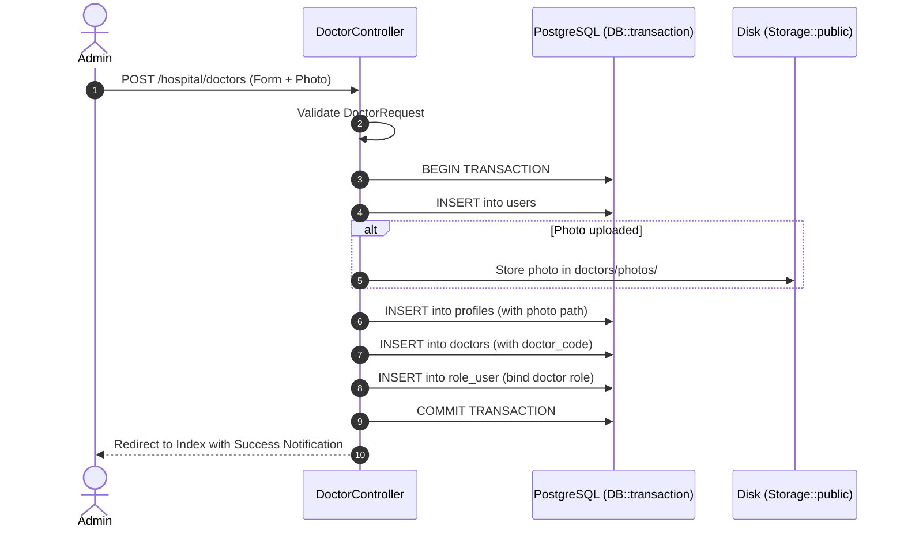
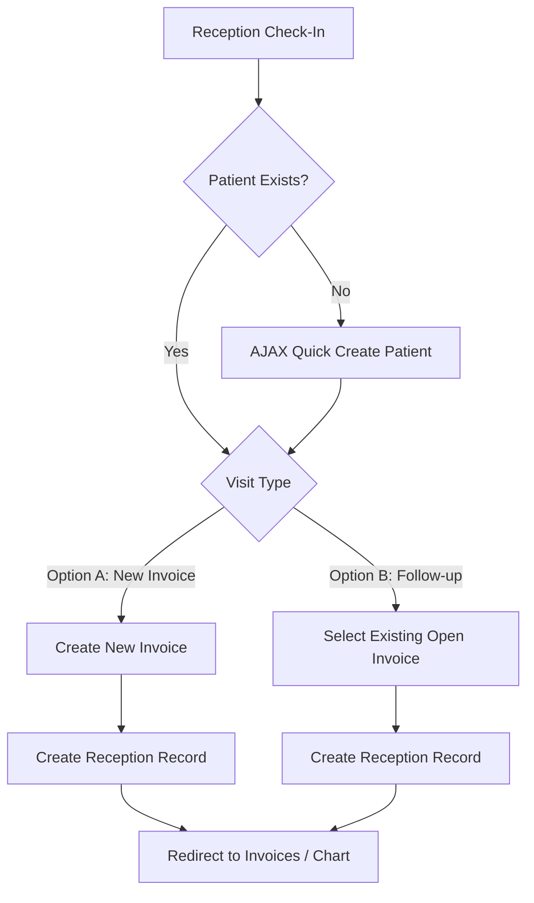
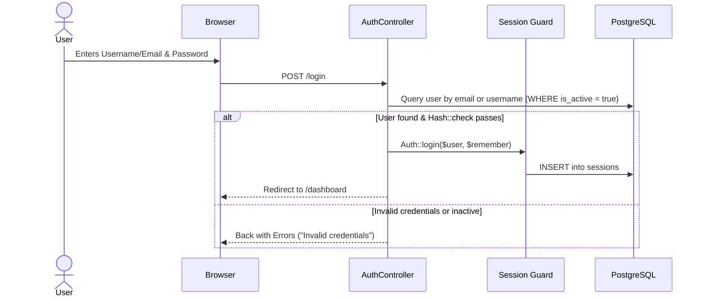

# Dental Chart System — Comprehensive CRUD Flow & Architecture Documentation

**Document Name:** `flow_crud.md`  
**Target Project:** Dental Chart & Hospital Management System (`dental-chart`)  
**Architecture:** Laravel 11.x Modular Monolith (`nwidart/laravel-modules`) on PostgreSQL  
**Primary Engine:** PHP 8.2+ / PostgreSQL 12+ / Blade / TailwindCSS / Alpine & Vanilla JS  
**Authoritative Reference:** This document is the primary technical guide for maintaining existing modules and implementing new features (e.g., Doctor, Patient, Appointment, Department).

---

> [!NOTE] Architecture & Stack Verification
> While the user prompt references "(Next.js + Supabase)", rigorous inspection of the workspace (`/home/sovann/p-project/dental-chart`) confirms that the **active, production codebase is built on Laravel 11 with PostgreSQL, Blade templates, and `nwidart/laravel-modules`**. No Next.js or Supabase runtime packages exist in the codebase (`Not Found in Codebase`).  
> 
> To serve as the definitive blueprint, this document:
> 1. Explains the verified **Laravel 11 Modular Architecture** in detail.
> 2. Maps the **PostgreSQL schema** generated in `schema.sql`.
> 3. Documents all **CRUD flows, database operations, business rules, and UI conventions**.
> 4. Provides a **Supabase / Next.js architectural transition matrix** in Section 5 and Section 14 so that future Next.js + Supabase developers can map existing models, services, and endpoints 1-to-1.

---

## 1. Project Overview

The **Dental Chart System** (OdontoCare) is an enterprise clinical and practice management system designed for dental clinics and hospitals. It manages:
- Patient records and medical history.
- Clinical dental charting (interactive odontogram for adult FDI 11–48 and pediatric FDI 51–85 dentition).
- Diagnostic conditions, surface tooth findings, and clinical notes.
- Doctor profiles, credentials, licensing, and professional fees.
- Clinical hospital services and retail consumable products organized by categories.
- Patient registration, visit check-in triage, and follow-up consultation tracking.
- Treatment billing invoices with itemized procedure lines, taxes, and discounts.
- Payment receipts and automated balance recalculations.
- User management with granular Role-Based Access Control (RBAC).
- Global clinic configuration and doctor income exclusion settings.

---

## 2. Technology Stack

### Backend & Core
- **Framework:** Laravel 11.57.0 (PHP ^8.2)
- **Modularity:** `nwidart/laravel-modules` v11.1.10
- **Database:** PostgreSQL 12+ (Connection `pgsql`, Port `5432`)
- **ORM:** Laravel Eloquent ORM with SoftDeletes, Casts, and Relationships
- **Queue & Cache:** Database drivers (`jobs`, `cache`, `sessions`)
- **Authentication:** Laravel Session Authentication with Custom Guard & RBAC Trait

### Frontend & UI
- **Template Engine:** Blade (`.blade.php`)
- **CSS Framework:** Tailwind CSS 3.4.13 + Custom CSS Variables
- **Icons:** Inline SVG icons (Lucide / Heroicons style)
- **UI Libraries:**
  - **Flatpickr:** Date pickers (standardized on `Y-m-d`)
  - **Select2 4.1.0-rc.0:** Searchable dropdowns
  - **SweetAlert2 11:** Delete confirmations and alert modals
  - **Custom Interactive SVG Odontogram:** Interactive SVG surfaces (`top`, `bottom`, `left`, `right`, `center`, `whole`)
- **Build Tool:** Vite 6.0.11 with `laravel-vite-plugin` and custom `vite-module-loader.js`

---

## 3. Project Folder Structure

The project employs a decoupled Modular Monolith structure:

```
dental-chart/
├── app/
│   ├── Http/Controllers/       # Base application controllers
│   ├── Models/                 # Backward-compatibility proxies extending Module models
│   └── Providers/              # Application service providers (AppServiceProvider)
├── bootstrap/
│   ├── app.php                 # Laravel 11 routing, middleware & exception handling configuration
│   └── providers.php           # Autoloaded providers
├── config/
│   ├── app.php                 # App timezone, locale, encryption
│   ├── database.php            # PostgreSQL database connection configuration
│   └── modules.php             # nwidart/laravel-modules configuration
├── database/
│   ├── factories/              # Database factories
│   ├── migrations/             # Core Laravel migrations (users, cache, jobs)
│   └── seeders/                # Core seeders (SuperAdminSeeder, DentalConditionSeeder)
├── Modules/                    # Core business domains
│   ├── ActivityLog/            # Audit logging & clinical action tracking
│   ├── Core/                   # Shared layouts (sidebar, header, app shell), dashboard
│   ├── DentalChart/            # Dental charts, chart teeth, odontogram view, findings sync
│   ├── DentalCondition/        # Standard dental conditions catalog & legend colors
│   ├── Hospital/               # Doctors, Services, Products, Service/Product Categories
│   ├── Invoice/                # Invoices, itemized invoice items, balance calculations
│   ├── Patient/                # Patient demographics, medical notes, charts index
│   ├── Payment/                # Payments, transaction receipts, invoice recalculation
│   ├── Register/               # Patient check-in, reception triage, visit workflow
│   ├── Setting/                # Clinic general settings, logo upload, doctor exclusions
│   ├── ToothFinding/           # Surface finding annotations & treatment statuses
│   └── User/                   # Authentication, User CRUD, Role CRUD, Permission Registry
├── public/                     # Document root (index.php, storage symlink, compiled assets)
├── resources/
│   ├── css/                    # Tailwind CSS definitions
│   ├── js/                     # Application JavaScript bootstrap
│   └── views/                  # Backward compatibility proxy views
├── routes/
│   ├── api.php                 # Global API route aggregator
│   ├── console.php             # Artisan console commands
│   └── web.php                 # Root web route file (delegates to Modules)
├── storage/                    # Uploaded files (doctors/photos, clinic logos), logs, cache
├── tests/                      # PHPUnit regression test suite (15 test suites, 109 assertions)
├── schema.sql                  # Verified complete PostgreSQL schema
├── schema-analysis.md          # Architectural database schema audit report
└── flow_crud.md                # This document
```

---

## 4. Application Architecture



### Key Architectural Highlights:
1. **Route Modularity:** Every module manages its own `routes/web.php` and `routes/api.php`, isolated under the module directory.
2. **Permission Gate:** Custom Gate interceptor `Gate::before()` handles `module:controller:action` permission checking. Super Admins bypass checks automatically.
3. **Multi-Table Transactions:** Complex writes (e.g. Doctor + User + Profile, Invoice + InvoiceItems, Register + Reception + Invoice) are wrapped in `DB::transaction()`.
4. **Soft Deletes:** Critical business entities (`patients`, `invoices`, `receptions`, `payments`, `doctors`, `services`, `categories`, `tooth_findings`) use Laravel's `SoftDeletes` (`deleted_at TIMESTAMP NULL`).

---

## 5. Supabase & PostgreSQL Configuration

### Actual Database Configuration (`.env`)
```ini
DB_CONNECTION=pgsql
DB_HOST=localhost
DB_PORT=5432
DB_DATABASE=dental_chart
DB_USERNAME=postgres
DB_PASSWORD=123
```

### PostgreSQL 12+ Compatibility
The schema has been authored strictly for PostgreSQL and verified via `schema.sql`:
- **Identity Sequences:** `BIGSERIAL PRIMARY KEY` for primary keys.
- **Foreign Keys:** Explicit table-level constraints with `ON DELETE CASCADE` or `ON DELETE SET NULL`.
- **Booleans:** `BOOLEAN NOT NULL DEFAULT TRUE/FALSE`.
- **Exact Decimals:** `NUMERIC(15, 2)` and `NUMERIC(10, 2)` for prices and balances.
- **Timestamps:** `TIMESTAMP(0) WITHOUT TIME ZONE NULL`.

### Supabase / Next.js Migration Mapping (Reference Guide)
If migrating this architecture to Next.js + Supabase:
- `users` table maps to `auth.users` + public `profiles`.
- Eloquent transactions map to Supabase Database Functions (RPC) written in PL/pgSQL.
- Laravel `AuthorizesWithPermissions` maps to Supabase Row Level Security (RLS) policies checking `auth.jwt()`.
- Blade FormRequests map to Zod schemas validated in Next.js Server Actions.
- SweetAlert2 maps to Sonner or Radix Toast with AlertDialog components.

---

## 6. Database Schema Overview

The database contains **26 verified tables**:

| Category | Tables | Primary Purpose |
|---|---|---|
| **Laravel System** | `users`, `password_reset_tokens`, `sessions`, `cache`, `cache_locks`, `jobs`, `job_batches`, `failed_jobs` | Framework internals, auth sessions, and queue management |
| **RBAC & Access** | `roles`, `permissions`, `role_user`, `permission_role` | Roles, permissions, and many-to-many user bindings |
| **Clinic Identity** | `clinic_settings`, `profiles`, `doctors` | Clinic branding, staff profiles, and doctor professional details |
| **Patient & Clinical** | `patients`, `dental_charts`, `chart_teeth`, `dental_conditions`, `tooth_findings` | Patient demographics, dental charting, conditions, and surface findings |
| **Catalog** | `categories`, `services` | Service categories, treatment services, and retail consumable products |
| **Billing & Payments**| `invoices`, `invoice_items`, `receptions`, `payments` | Check-in visits, invoices, line items, and payment transactions |

---

## 7. Database Table Relationships

```
USERS
 ├── (1:1) ── PROFILES          [users.id = profiles.user_id] (CASCADE)
 ├── (1:1) ── DOCTORS           [users.id = doctors.user_id] (CASCADE)
 ├── (M:N) ── ROLES             [via role_user] (CASCADE)
 ├── (1:M) ── DENTAL_CHARTS     [users.id = dental_charts.created_by] (SET NULL)
 ├── (1:M) ── DENTAL_CONDITIONS [users.id = dental_conditions.created_by] (SET NULL)
 ├── (1:M) ── INVOICES          [users.id = invoices.created_by] (SET NULL)
 ├── (1:M) ── RECEPTIONS        [users.id = receptions.created_by] (SET NULL)
 └── (1:M) ── PAYMENTS          [users.id = payments.created_by] (SET NULL)

ROLES
 └── (M:N) ── PERMISSIONS       [via permission_role] (CASCADE)

PATIENTS
 ├── (1:M) ── DENTAL_CHARTS     [patients.id = dental_charts.patient_id] (CASCADE)
 ├── (1:M) ── INVOICES          [patients.id = invoices.patient_id] (CASCADE)
 ├── (1:M) ── RECEPTIONS        [patients.id = receptions.patient_id] (CASCADE)
 └── (1:M) ── PAYMENTS          [patients.id = payments.patient_id] (CASCADE)

DENTAL_CHARTS
 └── (1:M) ── CHART_TEETH       [dental_charts.id = chart_teeth.dental_chart_id] (CASCADE)

CHART_TEETH
 └── (1:M) ── TOOTH_FINDINGS    [chart_teeth.id = tooth_findings.chart_tooth_id] (CASCADE)

DENTAL_CONDITIONS
 └── (1:M) ── TOOTH_FINDINGS    [dental_conditions.id = tooth_findings.dental_condition_id] (SET NULL)

CATEGORIES
 └── (1:M) ── SERVICES          [categories.id = services.category_id] (SET NULL)

INVOICES
 ├── (1:M) ── RECEPTIONS        [invoices.id = receptions.invoice_id] (CASCADE)
 ├── (1:M) ── INVOICE_ITEMS     [invoices.id = invoice_items.invoice_id] (CASCADE)
 └── (1:M) ── PAYMENTS          [invoices.id = payments.invoice_id] (CASCADE)

SERVICES
 └── (1:M) ── INVOICE_ITEMS     [services.id = invoice_items.service_id] (SET NULL)

RECEPTIONS
 └── (1:M) ── INVOICE_ITEMS     [receptions.id = invoice_items.reception_id] (SET NULL)
```

---

## 8. Entity Relationship Diagram (ERD)



---

## 9. Existing CRUD Modules Overview

| Module Name | Base Route | Controller | Primary Model |
|---|---|---|---|
| **Patient** | `/patients` | `PatientController` | `Patient` |
| **Dental Chart** | `/dental-charts`, `/dental` | `DentalChartController`, `DentalViewController` | `DentalChart`, `ChartTooth` |
| **Dental Condition** | `/dental-conditions` | `DentalConditionController` | `DentalCondition` |
| **Doctor** | `/hospital/doctors` | `DoctorController` | `Doctor`, `User`, `Profile` |
| **Service Category** | `/hospital/service-categories` | `ServiceCategoryController` | `Category` (`type='service'`) |
| **Product Category** | `/hospital/product-categories` | `ProductCategoryController` | `Category` (`type='product'`) |
| **Service** | `/hospital/services` | `ServiceController` | `Service` (`type='service'`) |
| **Product** | `/hospital/products` | `ProductController` | `Service` (`type='product'`) |
| **Register / Reception** | `/register` | `RegisterController` | `Reception`, `Patient`, `Invoice` |
| **Invoice** | `/invoices` | `InvoiceController` | `Invoice`, `InvoiceItem` |
| **Payment** | `/payments` | `PaymentController` | `Payment`, `Invoice` |
| **User** | `/users` | `UserController` | `User`, `Role` |
| **Role** | `/roles` | `RoleController` | `Role`, `Permission` |
| **Clinic Setting** | `/settings/general` | `GeneralSettingController` | `ClinicSetting` |

---

## 10. CRUD Workflows (Deep-Dive per Module)

---

### Module 1: Patient Management (`Modules/Patient`)

#### 1. Routes and Files
- **Routes:** `routes/web.php` -> `Modules/Patient/routes/web.php`
  - `GET /patients` (`patients.index`)
  - `GET /patients/create` (`patients.create`)
  - `POST /patients` (`patients.store`)
  - `GET /patients/{patient}` (`patients.show`)
  - `GET /patients/{patient}/edit` (`patients.edit`)
  - `PUT /patients/{patient}` (`patients.update`)
  - `DELETE /patients/{patient}` (`patients.destroy`)
- **Controller:** [`Modules/Patient/app/Http/Controllers/PatientController.php`](file:///home/sovann/p-project/dental-chart/Modules/Patient/app/Http/Controllers/PatientController.php)
- **Model:** [`Modules/Patient/app/Models/Patient.php`](file:///home/sovann/p-project/dental-chart/Modules/Patient/app/Models/Patient.php)
- **FormRequest:** [`Modules/Patient/app/Http/Requests/PatientRequest.php`](file:///home/sovann/p-project/dental-chart/Modules/Patient/app/Http/Requests/PatientRequest.php)
- **Views:** `Modules/Patient/resources/views/` (`index`, `create`, `edit`, `show`)

#### 2. Database Tables
- `patients`

#### 3. Relationships
- Has Many `dental_charts`
- Has Many `invoices`
- Has Many `receptions`
- Has Many `payments`

#### 4. List Workflow
1. Calls `$this->checkPermission('patient:patients:view')`.
2. Queries `Patient::query()->withCount(['dentalCharts', 'invoices', 'receptions'])`.
3. If search query is provided, performs case-insensitive search via PostgreSQL `LOWER(full_name) LIKE ?`, `patient_number`, `phone`.
4. Returns `latest()->paginate(15)->withQueryString()` to `patient::index`.

#### 5. Create Workflow
1. `GET /patients/create` displays `patient::create`.
2. Form submits `POST /patients`.
3. `PatientRequest` validates uniqueness of `patient_number` and required `full_name`.
4. Executes `Patient::create($request->validated())`.
5. Redirects to `patients.show` with flash message.

#### 6. Update Workflow
1. `GET /patients/{patient}/edit` displays `patient::edit`.
2. `PUT /patients/{patient}` validates with `Rule::unique('patients')->ignore($patient->id)`.
3. Executes `$patient->update($request->validated())`.
4. Redirects to `patients.show` with flash message.

#### 7. Delete Workflow
1. Form uses SweetAlert2 modal triggered by `.btn-delete-swal`.
2. Controller enforces business integrity rule:
   ```php
   if ($patient->invoices()->where('paid_amount', '>', 0)->exists()) {
       return back()->with('error', "Cannot delete patient because financial records exist.");
   }
   ```
3. If valid, calls `$patient->delete()` (Soft Delete).

#### 8. Validation Rules
- `patient_number`: `required|string|max:50|unique:patients,patient_number,{id}`
- `full_name`: `required|string|max:255`
- `date_of_birth`: `nullable|date`
- `sex`: `nullable|string|in:male,female,other`
- `phone`: `nullable|string|max:30`
- `address`: `nullable|string`
- `medical_notes`: `nullable|string`



---

### Module 2: Doctor Management (`Modules/Hospital`)

#### 1. Routes and Files
- **Routes:** `Modules/Hospital/routes/web.php`
  - `GET /hospital/doctors` (`hospital.doctors.index`)
  - `GET /hospital/doctors/create` (`hospital.doctors.create`)
  - `POST /hospital/doctors` (`hospital.doctors.store`)
  - `GET /hospital/doctors/{doctor}` (`hospital.doctors.show`)
  - `GET /hospital/doctors/{doctor}/edit` (`hospital.doctors.edit`)
  - `PUT /hospital/doctors/{doctor}` (`hospital.doctors.update`)
  - `DELETE /hospital/doctors/{doctor}` (`hospital.doctors.destroy`)
- **Controller:** [`Modules/Hospital/app/Http/Controllers/DoctorController.php`](file:///home/sovann/p-project/dental-chart/Modules/Hospital/app/Http/Controllers/DoctorController.php)
- **Models:** `Doctor`, `Profile`, `User`, `Role`
- **FormRequest:** [`Modules/Hospital/app/Http/Requests/DoctorRequest.php`](file:///home/sovann/p-project/dental-chart/Modules/Hospital/app/Http/Requests/DoctorRequest.php)

#### 2. Database Tables
- `doctors`
- `users`
- `profiles`
- `role_user`

#### 3. Relationships
- `doctors.user_id` -> `users.id` (1:1, CASCADE)
- `profiles.user_id` -> `users.id` (1:1, CASCADE)
- `users.id` <-> `roles.id` (M:N via `role_user`)

#### 4. Multi-Table Create Workflow (Transaction)
When creating a doctor, 4 database operations occur inside a single atomic transaction:
```php
DB::transaction(function () use ($request, $validated) {
    // 1. Create User
    $user = User::create([
        'name' => $validated['name'],
        'email' => $validated['email'],
        'username' => $username,
        'password' => Hash::make($validated['password']),
        'is_active' => true,
    ]);

    // 2. Upload Profile Photo & Create Profile
    $photoPath = $request->file('photo')?->store('doctors/photos', 'public');
    $profile = Profile::create([
        'user_id' => $user->id,
        'first_name' => $validated['first_name'],
        'last_name' => $validated['last_name'],
        'phone' => $validated['phone'],
        'photo' => $photoPath,
    ]);

    // 3. Create Doctor Record
    $doctor = Doctor::create([
        'user_id' => $user->id,
        'doctor_code' => $validated['doctor_code'] ?: Doctor::generateDoctorCode(),
        'specialization' => $validated['specialization'],
        'consultation_fee' => $validated['consultation_fee'],
        'status' => true,
    ]);

    // 4. Assign Doctor Role
    $doctorRole = Role::where('name', 'doctor')->first();
    if ($doctorRole) $user->assignRole($doctorRole);

    return $doctor;
});
```



---

### Module 3: Dental Chart & Odontogram (`Modules/DentalChart` & `Modules/ToothFinding`)

#### 1. Routes and Files
- **Routes:** `Modules/DentalChart/routes/web.php` and `routes/api.php`
  - `GET /dental-charts` (`dental-charts.index`)
  - `GET /dental/{dentalChart}` (`dental.show` - Interactive Odontogram)
  - `POST /api/dental-charts/{dentalChart}/sync-findings` (AJAX Finding Sync)
- **Controllers:**
  - `DentalChartController.php` (CRUD)
  - `DentalViewController.php` (Interactive odontogram viewer)
  - `DentalChartApiController.php` (REST sync endpoint)
- **Models:** `DentalChart`, `ChartTooth`, `ToothFinding`, `DentalCondition`

#### 2. Database Tables
- `dental_charts`
- `chart_teeth`
- `dental_conditions`
- `tooth_findings`

#### 3. Odontogram Architecture
1. Adult dentition represents **32 permanent teeth** (FDI numbers 11–18, 21–28, 31–38, 41–48).
2. Pediatric dentition represents **20 primary teeth** (FDI numbers 51–55, 61–65, 71–75, 81–85).
3. Each tooth has 5 anatomic polygon surfaces: `top`, `bottom`, `left`, `right`, `center`, plus `whole`.
4. Clicking a tooth surface opens the modal to assign a `dental_condition_id` with its assigned color code.
5. Findings are synced via JSON payload to `/api/dental-charts/{dentalChart}/sync-findings`.

```mermaid
flowchart LR
    Odontogram[Interactive SVG Tooth Surface] -->|Click Surface| Modal[Select Dental Condition]
    Modal -->|Apply| API[POST /api/dental-charts/{id}/sync-findings]
    API -->|Transaction| Upsert[UPSERT tooth_findings]
    Upsert --> ColorUpdate[SVG Surface Color Updated in Real-Time]
```

---

### Module 4: Patient Registration / Reception (`Modules/Register`)

#### 1. Routes and Files
- **Routes:** `Modules/Register/routes/web.php`
  - `GET /register` (`register.index`)
  - `POST /register` (`register.store`)
  - `GET /register/search-patients` (`register.search_patients` - AJAX Select2)
  - `GET /register/patient-invoices/{patient}` (`register.patient_invoices`)
  - `POST /register/quick-create-patient` (`register.quick_create_patient`)
- **Controller:** [`Modules/Register/app/Http/Controllers/RegisterController.php`](file:///home/sovann/p-project/dental-chart/Modules/Register/app/Http/Controllers/RegisterController.php)
- **Service:** [`Modules/Register/app/Services/RegistrationService.php`](file:///home/sovann/p-project/dental-chart/Modules/Register/app/Services/RegistrationService.php)
- **Models:** `Reception`, `Patient`, `Invoice`

#### 2. Workflows (Option A vs. Option B)
The registration module provides a dual triage workflow:
- **Option A (New Visit / New Invoice):**
  1. Patient is selected or quick-created.
  2. Generates a new unique `invoice_number` (`INV-YYYY-XXXX`).
  3. Creates an initial `Invoice` with status `unpaid`.
  4. Generates a new unique `reception_number` (`REC-XXXX`).
  5. Creates a `Reception` record linking `patient_id` and `invoice_id`.
- **Option B (Follow-up Visit / Reuse Existing Invoice):**
  1. Patient is selected.
  2. Displays existing eligible invoices (where status is not cancelled or refunded).
  3. Creates a new `Reception` record linked to the chosen existing `invoice_id`.



---

### Module 5: Invoices & Invoice Items (`Modules/Invoice`)

#### 1. Routes and Files
- **Routes:** `Modules/Invoice/routes/web.php`
  - `GET /invoices` (`invoices.index`)
  - `GET /invoices/create` (`invoices.create`)
  - `POST /invoices` (`invoices.store`)
  - `GET /invoices/{invoice}` (`invoices.show`)
  - `GET /invoices/{invoice}/edit` (`invoices.edit`)
  - `PUT /invoices/{invoice}` (`invoices.update`)
  - `DELETE /invoices/{invoice}` (`invoices.destroy`)
  - `GET /invoices/{invoice}/print` (`invoices.print`)
- **Controller:** [`Modules/Invoice/app/Http/Controllers/InvoiceController.php`](file:///home/sovann/p-project/dental-chart/Modules/Invoice/app/Http/Controllers/InvoiceController.php)
- **Models:** `Invoice`, `InvoiceItem`, `Service`, `Payment`

#### 2. Balance Recalculation Engine
The invoice model features an automated calculation pipeline in `Invoice::recalculateBalance()`:
$$\text{Line Amount} = (\text{Quantity} \times \text{Unit Price}) - \text{Line Discount} + \text{Line Tax}$$
$$\text{Subtotal} = \sum \text{Line Amount}$$
$$\text{Total Amount} = \max(0, \text{Subtotal} - \text{Invoice Discount} + \text{Invoice Tax})$$
$$\text{Paid Amount} = \sum \text{Completed Payments}$$
$$\text{Balance Amount} = \max(0, \text{Total Amount} - \text{Paid Amount})$$

$$\text{Status} = \begin{cases} 
\text{paid} & \text{if } \text{Total Amount} > 0 \text{ and } \text{Paid Amount} \ge \text{Total Amount} \\ 
\text{partial} & \text{if } \text{Paid Amount} > 0 \\ 
\text{unpaid} & \text{otherwise} 
\end{cases}$$

---

### Module 6: Payments & Receipts (`Modules/Payment`)

#### 1. Routes and Files
- **Routes:** `Modules/Payment/routes/web.php`
  - `GET /payments` (`payments.index`)
  - `GET /payments/create` (`payments.create`)
  - `POST /payments` (`payments.store`)
  - `GET /payments/{payment}` (`payments.show`)
  - `DELETE /payments/{payment}` (`payments.destroy`)
  - `GET /payments/{payment}/print` (`payments.print`)
- **Controller:** [`Modules/Payment/app/Http/Controllers/PaymentController.php`](file:///home/sovann/p-project/dental-chart/Modules/Payment/app/Http/Controllers/PaymentController.php)
- **Model:** `Payment`

#### 2. Business Integrity Rules
1. **Overpayment Prevention:** Controller validates that `amount <= invoice.balance_amount`.
2. **Atomic Balance Update:** Writes `Payment` inside a transaction and triggers `$invoice->recalculateBalance()`.
3. **Receipt Print View:** Renders an official clinical receipt displaying clinic header, logo, patient details, and invoice balance.

---

### Module 7: Role-Based Access Control (RBAC) (`Modules/User`)

#### 1. Routes and Files
- **Routes:** `Modules/User/routes/web.php` (`/users`, `/roles`)
- **Controllers:** `UserController.php`, `RoleController.php`, `AuthController.php`
- **Models:** `User`, `Role`, `Permission`
- **Trait:** `AuthorizesWithPermissions.php`, `HasRolesAndPermissions.php`
- **Support:** `PermissionRegistry.php`

#### 2. Authorization Flow
1. Permissions follow the format: `module:controller:action` (e.g. `hospital:doctors:create`, `patient:patients:delete`).
2. Every controller action calls:
   ```php
   $this->checkPermission('module:controller:action');
   ```
3. `Gate::before()` inspects if the authenticated user has `is_super_addmin = true` or the `super-admin` role, bypassing checks immediately.
4. Otherwise, it checks `user -> roles -> permissions` for an active match. If denied, it aborts with HTTP `403 Forbidden`.

---

## 11. Database Tables Used by Each CRUD Module

| Module | Primary Table | Related / Child Tables | Foreign Keys Used |
|---|---|---|---|
| **Patient** | `patients` | `dental_charts`, `invoices`, `receptions`, `payments` | None on `patients`; child tables reference `patients.id` |
| **Dental Chart** | `dental_charts` | `chart_teeth`, `patients`, `users` | `patient_id` -> `patients.id`, `created_by` -> `users.id` |
| **Chart Teeth** | `chart_teeth` | `dental_charts`, `tooth_findings` | `dental_chart_id` -> `dental_charts.id` |
| **Tooth Finding**| `tooth_findings` | `chart_teeth`, `dental_conditions`, `users` | `chart_tooth_id` -> `chart_teeth.id`, `dental_condition_id` -> `dental_conditions.id` |
| **Doctor** | `doctors` | `users`, `profiles`, `role_user` | `doctors.user_id` -> `users.id`, `profiles.user_id` -> `users.id` |
| **Categories** | `categories` | `services` | `categories.hospital_id` (unconstrained) |
| **Services** | `services` | `categories`, `invoice_items` | `services.category_id` -> `categories.id` |
| **Register** | `receptions` | `patients`, `invoices`, `users` | `patient_id` -> `patients.id`, `invoice_id` -> `invoices.id` |
| **Invoice** | `invoices` | `invoice_items`, `patients`, `users` | `patient_id` -> `patients.id`, `created_by` -> `users.id` |
| **Invoice Item** | `invoice_items` | `invoices`, `services`, `receptions` | `invoice_id` -> `invoices.id`, `service_id` -> `services.id`, `reception_id` -> `receptions.id` |
| **Payment** | `payments` | `invoices`, `patients`, `users` | `invoice_id` -> `invoices.id`, `patient_id` -> `patients.id` |
| **User** | `users` | `profiles`, `doctors`, `role_user` | None on `users`; referenced by `profiles`, `doctors`, `role_user` |
| **Role** | `roles` | `role_user`, `permission_role` | None on `roles`; referenced by `role_user`, `permission_role` |
| **Setting** | `clinic_settings` | None (singleton) | Stores excluded doctor IDs as `JSON` array |

---

## 12. Authentication Workflow



### Logout Flow:
1. User clicks Logout in Header (`POST /logout`).
2. Calls `Auth::logout()`, invalidates session, regenerates CSRF token.
3. Redirects to `/login`.

---

## 13. UI/UX CRUD Design Patterns & Reusable Components

All views extend `Modules/Core/resources/views/layouts/app.blade.php`:

### 1. Collapsible Sidebar
- Persists state in `localStorage.getItem('odonto_sidebar_collapsed')`.
- Mobile responsive drawer with `#sidebarBackdrop`.

### 2. Standard Filter Bar (Index Views)
Every index page features a card with search input, dropdown filters, and clear button:
```html
<form method="GET" action="{{ route('module.index') }}" class="filter-form">
    <input type="text" name="search" value="{{ request('search') }}" placeholder="Search..." class="form-control">
    <select name="status" class="form-control select2">...</select>
    <button type="submit" class="btn btn-primary">Filter</button>
    <a href="{{ route('module.index') }}" class="btn btn-secondary">Clear</a>
</form>
```

### 3. DatePickers (Flatpickr)
- Target: `<input type="date">` or `<input class="datepicker">`.
- Format: Standardized on `Y-m-d`.
- Initialized automatically via global `initDatepickers()`.

### 4. Searchable Selects (Select2)
- Target: `<select class="select2">`.
- Initialized automatically via global `initSelect2()`.

### 5. Table Column Visibility Dropdown
- Every data table automatically receives a **"Columns"** toggle dropdown.
- User column visibility preferences are stored per user in `localStorage`.

### 6. Delete Action Confirmation (SweetAlert2)
Standardized delete button markup across all tables:
```html
<form action="{{ route('module.destroy', $item) }}" method="POST" 
      data-type="item" data-name="{{ $item->name }}">
    @csrf
    @method('DELETE')
    <button type="button" class="btn btn-sm btn-outline-danger btn-delete-swal">
        <svg class="w-4 h-4">...</svg>
    </button>
</form>
```

---

## 14. How to Implement a New CRUD Module

Follow this step-by-step checklist when introducing any new module (e.g. `Department`, `Appointment`):

### Step 1: Create the Module
```bash
php artisan module:make Department
```

### Step 2: Define the Migration
Create the database migration in `Modules/Department/database/migrations/`:
```php
Schema::create('departments', function (Blueprint $table) {
    $table->id();
    $table->string('name')->unique();
    $table->string('code', 50)->unique();
    $table->text('description')->nullable();
    $table->boolean('is_active')->default(true);
    $table->foreignId('created_by')->nullable()->constrained('users')->nullOnDelete();
    $table->timestamps();
    $table->softDeletes();
});
```

### Step 3: Define the Eloquent Model
In `Modules/Department/app/Models/Department.php`:
```php
namespace Modules\Department\Models;

use Illuminate\Database\Eloquent\Model;
use Illuminate\Database\Eloquent\SoftDeletes;
use Illuminate\Database\Eloquent\Factories\HasFactory;

class Department extends Model
{
    use HasFactory, SoftDeletes;

    protected $fillable = ['name', 'code', 'description', 'is_active', 'created_by'];

    protected function casts(): array
    {
        return ['is_active' => 'boolean'];
    }
}
```

### Step 4: Define the FormRequest
In `Modules/Department/app/Http/Requests/DepartmentRequest.php`:
```php
public function rules(): array
{
    $id = $this->route('department')?->id;
    return [
        'name' => ['required', 'string', 'max:255', Rule::unique('departments')->ignore($id)],
        'code' => ['required', 'string', 'max:50', Rule::unique('departments')->ignore($id)],
        'is_active' => ['boolean'],
    ];
}
```

### Step 5: Implement the Controller
Use `AuthorizesWithPermissions` and standard CRUD methods:
```php
namespace Modules\Department\Http\Controllers;

use App\Http\Controllers\Controller;
use Modules\Department\Models\Department;
use Modules\Department\Http\Requests\DepartmentRequest;
use Modules\User\Traits\AuthorizesWithPermissions;

class DepartmentController extends Controller
{
    use AuthorizesWithPermissions;

    public function index() {
        $this->checkPermission('department:departments:view');
        $departments = Department::latest()->paginate(15);
        return view('department::index', compact('departments'));
    }
    // Implement create, store, show, edit, update, destroy...
}
```

### Step 6: Register Permissions
Add module permissions to `Modules/User/app/Support/PermissionRegistry.php` so the admin can toggle them in the Role Management UI.

### Step 7: Register Web Routes & Sidebar Link
In `Modules/Department/routes/web.php`:
```php
Route::middleware('auth')->group(function () {
    Route::resource('departments', DepartmentController::class);
});
```
Add the menu entry in `Modules/Core/resources/views/layouts/sidebar.blade.php`.

---

## 15. Important Business Rules and Dependencies

1. **Financial Integrity on Patient Deletion:**
   - A patient cannot be deleted if they possess invoices with recorded payments (`paid_amount > 0`).
2. **Invoice Recalculation:**
   - Whenever items or payments are created, edited, or deleted, `$invoice->recalculateBalance()` must be triggered immediately.
3. **Doctor Account Synchronization:**
   - Doctor records must always have a linked `User` and `Profile`. Soft-deleting a doctor retains the user credentials for audit logs.
4. **Clinic Settings Doctor Exclusion:**
   - Doctors listed in `clinic_settings.except_doctor_ids` are omitted from clinic-wide commission calculations.

---

## 16. Potential Issues & Recommendations

1. **Database Connection in Migrations:**
   - Several migrations check `Schema::hasColumn(...)`. Ensure a valid PostgreSQL connection exists before running migrations to avoid runtime exceptions.
2. **Strict Foreign Key Ordering:**
   - When deploying to new environments, always run migrations or import `schema.sql` in the exact tier order documented in Section 7 to satisfy foreign key integrity.
3. **Storage Symlink:**
   - Ensure `php artisan storage:link` has been executed so doctor profile photos and clinic logos render properly.

---

*This document is the verified reference manual for the Dental Chart System.*

